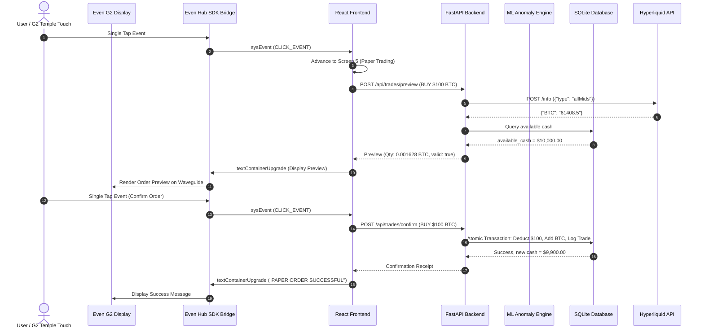

# DeFi Guardian — System Architecture

DeFi Guardian is engineered as an end-to-end wearable crypto intelligence and paper-trading platform designed for the Even Realities G2 smart glasses and the Even Hub runtime.

---

## 1. High-Level Architecture Diagram

```mermaid
flowchart TD
    subgraph WearableHardware ["Even Realities G2 Smart Glasses"]
        G2Display["Monochrome Green Waveguide HUD\n(576 × 288 px)"]
        G2Touch["Temple Touch Sensor\n(Tap, Double-Tap, Swipe)"]
    end

    subgraph PhoneOrSimulator ["Even Hub Runtime / Mobile Companion"]
        SDKBridge["Even Hub SDK Bridge\n(@evenrealities/even_hub_sdk)"]
        ReactApp["React 18 + TypeScript Application\n(Vite Dev Server :5173)"]
        CompanionUI["Companion Dashboard & Simulator Controls"]
    end

    subgraph PythonBackend ["Python FastAPI Backend (:8000)"]
        APIRouters["FastAPI Routers\n(/health, /market, /intelligence, /trading, /portfolio, /alerts, /wallet)"]
        MLEngine["Local ML Anomaly Engine\n(Scikit-Learn IsolationForest)"]
        PaperEngine["Paper Trading Engine\n(Stateful Buy/Sell Simulation)"]
        SQLiteDB[("SQLite Database\n(defi_guardian.db)")]
    end

    subgraph ExternalAPIs ["Real Cryptocurrency Data"]
        HyperliquidAPI["Hyperliquid Public Info API\n(allMids, candleSnapshot, clearinghouseState)"]
        CoinGeckoAPI["Optional CoinGecko Demo API"]
    end

    %% Interactions
    G2Touch -->|Hardware Gestures| SDKBridge
    SDKBridge -->|sysEvent / textEvent| ReactApp
    ReactApp -->|textContainerUpgrade| SDKBridge
    SDKBridge -->|Optical Projection| G2Display

    ReactApp <-->|REST API (HTTP/JSON)| APIRouters
    APIRouters <--> MLEngine
    APIRouters <--> PaperEngine
    PaperEngine <--> SQLiteDB
    APIRouters <--> HyperliquidAPI
    APIRouters -.-> CoinGeckoAPI
```

---

## 2. Component Breakdown

### 2.1 Wearable Frontend (`frontend/`)
- **Technology:** React 18, TypeScript 5.7, Vite 5.4, Tailwind CSS.
- **Even Hub SDK Integration:**
  - `waitForEvenAppBridge()`: Attaches to the native Flutter bridge provided by the Even Hub companion app or the official Even Hub Simulator.
  - `createStartUpPageContainer()`: Allocates initial full-canvas text containers on the G2 glasses at startup.
  - `textContainerUpgrade()`: High-frequency in-place text container replacement without full-canvas redraws.
  - `onEvenHubEvent()`: Subscribes to hardware gestures. Resolves protobuf zero-value click events (`CLICK_EVENT = 0`) safely inside the `sysEvent` / `textEvent` envelope check.
- **Display Output:** Formatted strictly for the G2 display constraints (576 × 288 pixels, pure black background `#000000`, 16-shade green monochrome palette).

### 2.2 Python Backend (`backend/`)
- **Technology:** Python 3.11, FastAPI, Pydantic V2, HTTPX, SQLite3.
- **Services:**
  - `HyperliquidService`: Asynchronous client querying `https://api.hyperliquid.xyz/info`. Implements in-memory TTL caching (3s for prices, 15s for candles) and stale-cache fallback during transient network hiccups.
  - `AnomalyEngine`: Extracts 5 statistical features from historical hourly candles and trains an `IsolationForest` on completed historical candles to evaluate the latest candle without lookahead bias.
  - `PaperTradingService`: Simulates order preview and execution against live Hyperliquid prices, enforcing balance validation and committing trades atomically to SQLite.
  - `AlertsService`: Evaluates target price thresholds against incoming market ticks.

### 2.3 Local Machine Learning Pipeline
1. **Data Ingestion:** Retrieves 48–120 historical hourly candles from Hyperliquid's `candleSnapshot` endpoint.
2. **Feature Engineering:**
   - Log return: $r_t = \ln(close_t / open_t)$
   - Candle range %: $range_t = (high_t - low_t) / open_t \times 100$
   - Candle body conviction %: $body_t = |close_t - open_t| / (high_t - low_t + 10^{-8}) \times 100$
   - Log volume: $v_t = \ln(volume_t + 10^{-8})$
   - Relative volume: $rel\_vol_t = volume_t / (\text{mean}(volume_{t-24 \dots t-1}) + 10^{-8})$
3. **Training & Inference:** Trains `IsolationForest(n_estimators=100, contamination=0.1, random_state=42)` on historical candles. Evaluates the most recent completed candle separately.
4. **Deterministic Explanation:** Constructs natural-language explanations directly from feature percentiles (e.g., "Volume is 3.1x higher than recent 24h baseline").

### 2.4 Persistence Layer (`SQLite`)
- `paper_account`: Singleton table managing initial ($10,000) and available simulated cash.
- `paper_holdings`: Tracks coin holdings (BTC, ETH, SOL), quantities, and weighted average buy prices.
- `paper_trades`: Complete audit trail of executed paper orders with timestamps, prices, and resulting balances.
- `price_alerts`: Active and triggered price alert thresholds.
- `app_settings`: Key-value configuration for the optional public Hyperliquid wallet address.

---

## 3. Data Flow Sequence



---

## 4. Hardware and Network Security
- **No Private Keys:** The system is strictly non-custodial and never touches private keys or exchange API secrets.
- **Whitelist Security:** `app.json` restricts outbound network permissions strictly to the configured backend origin (`http://127.0.0.1:8000`).
- **CORS Guardrails:** FastAPI is configured with CORS origin allowances for local development and simulator testing.
